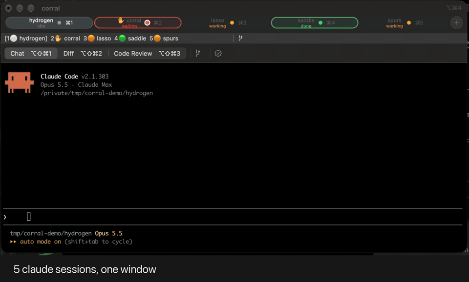
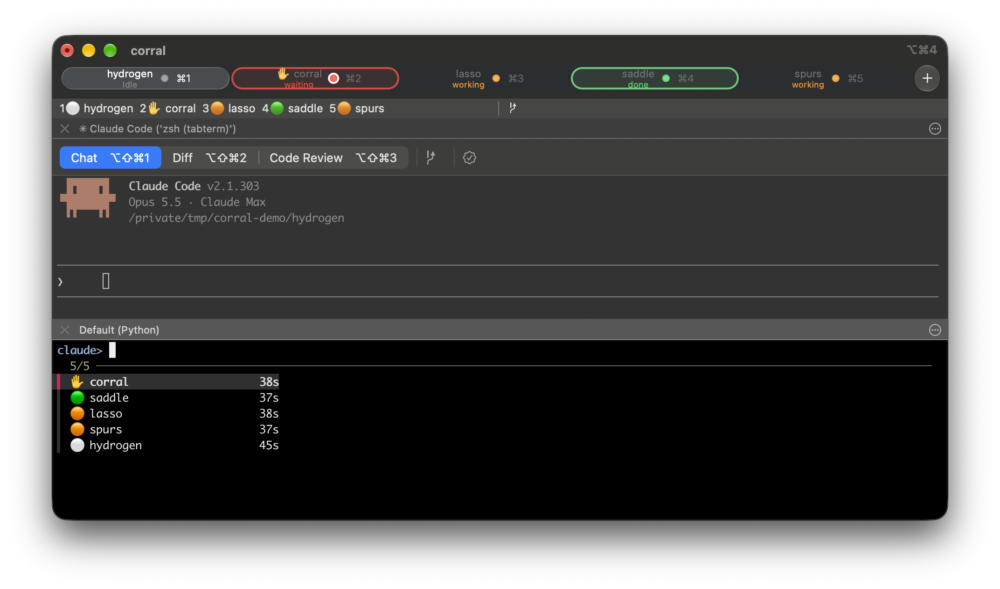
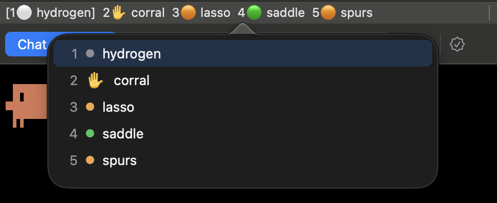
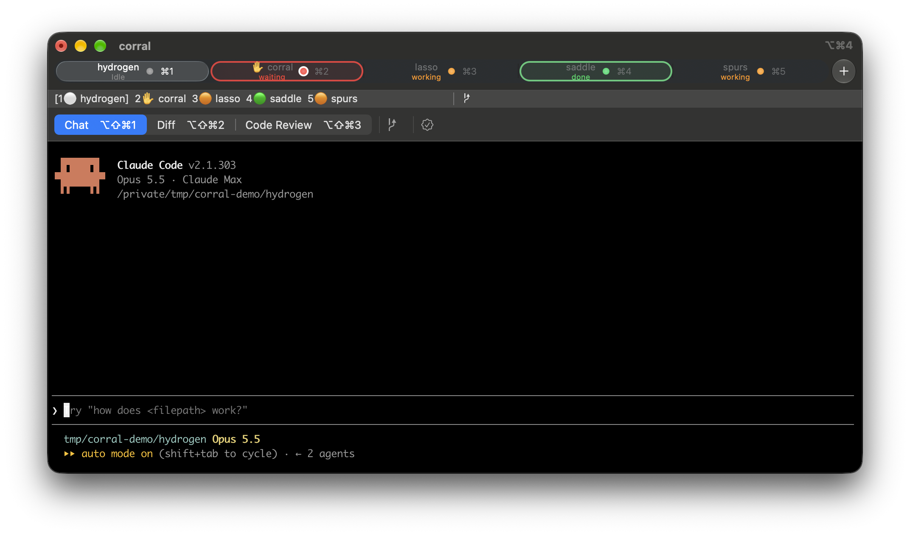

# corral

[](https://github.com/kayluhb/corral/actions/workflows/ci.yml)
[](https://github.com/kayluhb/corral/releases)
[](LICENSE)


[](https://claude.com/claude-code)

Round up your Claude Code sessions. 🤠



Keyboard-first status for many `claude` sessions running in ordinary iTerm2 tabs.
Claude Code hooks record each session's state. A small daemon, started by the hook and
talking to iTerm2's Python API, uses that state to show a status bar summary, colour the tabs that need you and send notifications. Three
hotkeys jump to the sessions that need you. Each window shows and jumps between only its own
claude tabs. Nothing replaces your tabs or needs clicking.

## Requirements

- macOS with iTerm2. iTerm2 3.7 or later is optional; see [States](#states).
- [uv](https://docs.astral.sh/uv/) and `jq`. The install script installs `fzf` with Homebrew if
  it's missing.
- Claude Code.

## Install

```sh
git clone --branch v1.0.0 https://github.com/kayluhb/corral.git
cd corral
./install.sh
```

The script installs corral from this folder in editable mode, so keep the folder. To upgrade,
`git fetch --tags && git checkout <new tag>` and run `./install.sh` again.

If iTerm2's Python API is off, the script turns it on (Settings → General → Magic →
**Enable Python API**) and asks you to restart iTerm2 and run it again.

The script:

- runs `uv tool install`, which provides `corral` and `corral-hook`;
- merges hook entries into `~/.claude/settings.json`, backing up the original once to
  `settings.json.corral-bak`;
- runs `corral setup`, which adds the corral item to your default profile's status bar and
  binds the hotkeys below. It is safe to re-run, and it never replaces a key you already use.

Restart running `claude` sessions so they load the hooks. The daemon starts on the next
hook event in iTerm. It runs from inside iTerm, so iTerm trusts it without an approval
prompt. It exits when iTerm quits and starts again with the next claude event.

## Hotkeys

| Key | Function | Does |
|---|---|---|
| ⌘J | `corral_next_waiting` | Focus the session in this window that has waited longest for you. Press again to cycle. |
| ⌘⇧J | `corral_next_done` | Same, for finished sessions you haven't looked at yet. |
| ⌘P | `corral_pick` | Open an fzf switcher over this window's sessions in a temporary split. Enter jumps to the session; Esc or ⌘P again cancels. |



Click the corral status bar item to open a list of this window's claude tabs; click one to jump to it.



## Settings

Run `corral settings` for an arrow-key menu (↑↓ to move, Enter or Space to change, q to quit).
Changes apply straight away. They're stored in `~/.config/corral/settings.json`, or the path in
`CORRAL_CONFIG`.

| Setting | Values | Default |
|---|---|---|
| Group by project | on / off: sessions of one project collapse into one entry, like `1 hydrogen ✋🟠⚪`, and the popover lists them under project headings | off |
| Tab colours | on / off | on |

## Restore

Run `corral` (or `corral restore`) to reopen the claude sessions that were running when iTerm
last quit. It lists them and asks before opening anything. It opens a new window with one tab
per session, in the old tab order, and runs `claude --resume <id>` in each tab's own folder.

The daemon keeps a history of claude sessions in `~/.local/state/corral/restore/history.json`
and forgets entries after a week. "Last time" means the sessions that stopped within 30 seconds
of the most recent one to stop. Quitting iTerm stops them all together. Tabs you closed earlier,
one at a time, aren't included, and neither is anything still running.

## States

| State | Icon | Tab colour | Meaning |
|---|---|---|---|
| waiting | ✋ | red | Permission prompt, question or agent input needed |
| working | 🟠 | none | Prompt submitted or tool running |
| done | 🟢 | green | Claude finished. Becomes idle once you focus the tab |
| idle | ⚪ | none | Session open, nothing pending |

With iTerm2 3.7's Claude Code integration installed (iTerm2 → Install Claude Code Integration),
corral takes each session's state from iTerm, which notices background work sooner. Done still
becomes idle once you focus the tab. Sessions iTerm reports nothing for use corral's own hooks.



The status bar lists the claude tabs in its own window, in tab order: its tab number (the ⌘N), state and
project, with the tab you're in bracketed, for example `1✋ hydrogen  [2🟠 corral]  3🟢 lasso`.
When the bar is narrow it drops idle tabs, then falls back to counts (`✋1 🟠1 🟢1`). With nothing
going on in the window it reads `all quiet`. Tab colours, titles and notifications
still cover every window. A colour is never shown on the tab you're
currently in. You get a notification only for sessions you're not looking at.

A claude tab's title also starts with ✋ when it needs you (a split tab shows ✋ if any of its
sessions is waiting). Other tabs keep their normal title: Claude Code already marks working and
idle, and iTerm's tab status dot marks done. The title goes back to normal once the tab moves on.

## Development

```sh
uv sync
uv run pytest
uv run ruff check && uv run ruff format --check
```

State files live in `~/.local/state/corral/`, one per iTerm session. Set `CORRAL_STATE_DIR` to
override the location. The daemon logs to `~/Library/Logs/corral.log`. Set
`CORRAL_NO_AUTOSTART=1` to stop the hook from starting it.

## Uninstall

```sh
uv tool uninstall corral
pkill -f "corral.cli daemon"
rm -rf ~/.local/state/corral
```

Remove the corral status bar item and the three hotkeys in iTerm2 Settings.
Then remove the hook entries whose command is `corral-hook` from `~/.claude/settings.json`,
or restore `settings.json.corral-bak`.

## Known limitations

- If you deny a permission prompt, the session stays "waiting" until Claude's next event. That is usually Stop, after which it shows as done.
- A claude that is killed without a SessionEnd keeps a stale state until its tab closes or a new claude starts there.
- On the tab you're in, corral sets "no custom tab colour", which overrides any custom tab colour in your profile.
- The hook takes about 30ms per call and runs on every tool use.
